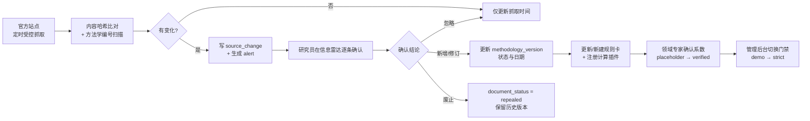
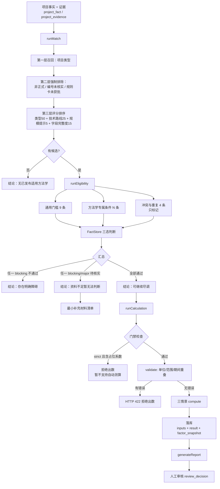

# 系统架构与技术方案

---

## 一、技术选型

| 层 | 选型 | 理由 |
|---|---|---|
| 运行时 | Node.js ≥ 22.5（实测 24.14.1） | 提供内置 `node:sqlite`、`node:http`、`node:test`、`fetch`，**零第三方依赖** |
| 数据库 | SQLite（WAL 模式，`PRAGMA foreign_keys = ON`） | 单机构单实例规模下足够；单文件便于备份与内网离线迁移；无需独立数据库服务 |
| 后端 | 原生 `node:http` + 自建极简路由表 | 路由数量可控（40 余条），无需框架；避免内网安装依赖 |
| 前端 | 原生 HTML / CSS / ES Module，无构建步骤 | 后端静态托管即可；内网浏览器直接可用；便于机构审计全部代码 |
| 计算 | 纯函数插件 + JSON 表达式树规则引擎 | 确定性、可审计、可复算；不使用 `eval`，不由大模型生成数值 |
| 测试 | `node:test`（按文件在进程内执行） | 零依赖；每个测试文件使用独立临时数据库 |

**显式的技术取舍**：
- **不使用 ORM**：SQL 直接写在服务层，schema 以 `src/db/schema.sql` 为唯一事实来源，便于审计与 DBA 复核。
- **不使用外部大模型 API**：设计文档要求「外部模型调用须走受控出口，并由机构确认数据可否离开内网」。
  本原型把 LLM 可能承担的职责全部落在确定性代码上：
  - 字段抽取 → 由人工在项目档案中录入（并保留 `source_kind` 与证据定位）
  - 变更摘要 → 由内容哈希差异 + 研究员人工填写 `diff_summary`
  - 报告草稿 → 由模板函数 `assembleReport()` 从结构化数据生成
  这样做牺牲了「自动抽取」的便利，换取**完全离线可运行、结论可复算、无数据外流风险**。
  后续若接入 LLM，只需替换上述三个入口，判断与计算链路不受影响。

---

## 二、分层结构

```
┌──────────────────────────────────────────────────────────────────────────┐
│  表现层  web/                                                            │
│    index.html · app.js · styles.css                                      │
│    8 个页面：总览看板 / 信息雷达 / 方法学库 / 项目档案与筛选 /            │
│              人工审核 / 管理后台 / 边界与说明 / 报告                      │
└───────────────────────────────┬──────────────────────────────────────────┘
                                │ fetch (JSON, Authorization: Bearer / ccer_session Cookie)
┌───────────────────────────────▼──────────────────────────────────────────┐
│  接口层  src/server.mjs                                                  │
│    路由表 · 会话鉴权(resolveSession) · 回环限制 · 统一响应规约 · 静态托管  │
└───────────────────────────────┬──────────────────────────────────────────┘
                                │
┌───────────────────────────────▼──────────────────────────────────────────┐
│  服务层  src/services/                                                   │
│    project-svc   项目/事实/证据/授权/运行记录                             │
│    engine        候选方法学匹配 + 申报条件检查（三层规则编排）             │
│    calc-svc      计算编排：输入解析 → 门禁 → 校验 → 计算 → 快照落库       │
│    report-svc    报告组装 / 三层导出 / 人工审核                           │
│    radar-svc     来源同步 / 变更比对 / 告警 / 订阅 / 审计 / 看板           │
│    seed          初始化：来源库 / 方法学目录 / 字段字典 / 规则 / 因子      │
└───────────┬──────────────────────────────┬───────────────────────────────┘
            │                              │
┌───────────▼──────────────┐   ┌───────────▼───────────────────────────────┐
│  判断层  src/rules/      │   │  计算层  src/methodologies/               │
│    engine.mjs            │   │    index.mjs       插件注册表              │
│      三态判断引擎         │   │    lib/global-factors.mjs  全局常数        │
│      事实访问 + 证据策略   │   │    lib/calc-kit.mjs        数值与校验工具   │
│    common.mjs            │   │    ccer-10-001.mjs  规则卡 + 插件          │
│      9 条通用门槛         │   │    ccer-10-002.mjs                        │
│      4 条冲突标记         │   │    ccer-10-003.mjs                        │
└───────────┬──────────────┘   │    ccer-10-004.mjs                        │
            │                  └───────────┬───────────────────────────────┘
            │                              │
┌───────────▼──────────────────────────────▼───────────────────────────────┐
│  数据层  src/core/db.mjs · src/db/schema.sql                             │
│    SQLite（21 张表）· 审计日志 · 系统元数据                                │
└──────────────────────────────────────────────────────────────────────────┘
            ▲
            │  只读来源
┌───────────┴──────────────────────────────────────────────────────────────┐
│  数据与配置  src/data/                                                   │
│    catalog.mjs        官方来源 + 方法学目录（每条标注官方出处）            │
│    fact-fields.mjs    项目事实字段字典（55 个字段）                        │
│    standard-codes.mjs 标准与依据编码表                                     │
└──────────────────────────────────────────────────────────────────────────┘
```

---

## 三、关键流程

### 3.1 政策与方法学变更流程



**硬约束**：抓取环节（`syncSources`）**只写** `source_change` 与 `alert`，绝不触碰 `methodology_version`。
已由 `test/04-catalog-and-governance.test.mjs`「抓取结果不会自动修改方法学状态」断言保护。

### 3.2 项目筛选判定流程



### 3.3 证据策略（三态判断的核心）

```text
规则 evidence_policy = 'strict' 时，字段要达到「通过」必须同时满足：
    source_kind ∈ { official, project_doc }
    且 evidence_id 非空
    且所引用的证据记录存在

否则返回「待核实」，并给出具体原因：
    · 字段缺失 / 为空
    · 来源为「业主自述」，该规则要求官方文件或项目资料证据
    · 该规则要求附带证据定位（文件+页码），当前事实无证据
    · 所引用的证据记录不存在（可能已删除）

source_kind = 'assumption'（模型假设）在任何规则下都返回「待核实」，
只能进入计算情景，永不参与条件判定。
```

### 3.4 版本快照与可复算

```text
calculation_run 同时写入：
  inputs_json           本次实际使用的全部输入值与每一项的来源标注
  result_json           逐式明细、年度序列、计入期汇总、假设、缺失、敏感性
  factor_snapshot_json  本次实际用到的因子快照（含 value_status 与 source_ref）
  analysis_base_date    分析基准日
  plugin_version        插件版本

→ 报告通过 snapshot_json 引用上述运行 ID
→ 库中因子更新后，历史运行与历史报告的内容不变
→ compareRuns(a, b) 输出输入差异、因子差异与差异原因说明
```

---

## 四、目录结构

```text
ccer-screening/
├── package.json                  零依赖；scripts: start / seed / test / docs
├── README.md                     快速上手
├── src/
│   ├── server.mjs                HTTP 服务与路由表
│   ├── core/
│   │   ├── db.mjs                连接、迁移、查询助手、审计
│   │   └── util.mjs              ID、日期、JSON、数值与范围工具
│   ├── db/
│   │   └── schema.sql            21 张表的 DDL（唯一事实来源）
│   ├── data/
│   │   ├── catalog.mjs           官方来源 + 方法学目录
│   │   ├── fact-fields.mjs       项目事实字段字典（55 字段）
│   │   └── standard-codes.mjs    标准与依据编码表
│   ├── rules/
│   │   ├── engine.mjs            三态判断引擎 + FactStore
│   │   └── common.mjs            通用门槛与冲突规则（随目录动态生成）
│   ├── methodologies/
│   │   ├── index.mjs             插件注册表（按 编号::版本 注册）
│   │   ├── lib/
│   │   │   ├── global-factors.mjs  全局物理常数（含复算依据）
│   │   │   └── calc-kit.mjs        步进器、因子注册表、校验、敏感性
│   │   ├── ccer-10-001.mjs       规则卡 + 计算插件 + 自检样例
│   │   ├── ccer-10-002.mjs
│   │   ├── ccer-10-003.mjs
│   │   └── ccer-10-004.mjs
│   └── services/
│       ├── seed.mjs              初始化与示例项目
│       ├── project-svc.mjs       项目 / 事实 / 证据 / 授权
│       ├── engine.mjs            匹配 + 条件检查
│       ├── calc-svc.mjs          计算编排
│       ├── report-svc.mjs        报告 / 导出 / 审核
│       └── radar-svc.mjs         来源 / 告警 / 订阅 / 审计 / 看板
├── web/                          前端（无构建）
│   ├── index.html
│   ├── app.js
│   └── styles.css
├── test/                         66 项自动化测试
│   ├── helpers.mjs               临时库夹具与合规措辞检查
│   ├── 01-rule-engine.test.mjs   11 项：三态判断与证据策略
│   ├── 02-acceptance.test.mjs    9 项：7 个关键验收用例
│   ├── 03-calculation.test.mjs   12 项：独立复算与门禁
│   └── 04-catalog-and-governance.test.mjs 14 项：目录纪律与治理
├── scripts/
│   ├── seed.mjs                  初始化 / 重建数据库
│   ├── gen-docs.mjs              生成方法学清单与字段表
│   ├── run-collection.mjs        定时采集任务入口
│   └── backup.mjs                数据库备份与校验
├── docs/                 15 份设计与交付文档
└── data/                         运行时数据（SQLite 文件）
```

---

## 五、部署形态

### 5.1 单机内网部署（当前形态）

```text
机构内网服务器
  └── node src/server.mjs
        监听 127.0.0.1:8787（或经 HOST 绑定内网地址 + CCER_ALLOW_REMOTE=1）
        静态托管 web/
        SQLite 文件落于 data/ccer.db
        ▲
        │ 受控出口（由机构网络策略控制）
        └── 生态环境部 / 注册登记系统站点（仅信息雷达抓取使用）
```

### 5.2 设计文档建议的技术结构对照

设计文档第 8 节建议由以下部件组成。本原型用一个 Node 进程实现了全部部件，
下表说明每个建议部件的对应实现与生产化建议：

| 建议部件 | 本原型实现 | 生产化建议 |
|---|---|---|
| 前端工作台 | `web/`（原生，8 个页面） | 如需更强交互可迁移至组件框架；当前形态便于内网审计 |
| 后端业务 API | `src/server.mjs` + `src/services/` | 拆分出独立鉴权与网关层 |
| 文档 / OCR 服务 | **未实现**（证据由人工录入文件名与页码） | 接入文档解析服务，自动生成证据候选记录（G-09） |
| 检索索引 | SQLite `LIKE` 检索 | 数据量上万后引入全文索引（SQLite FTS5 或独立检索引擎） |
| 结构化数据库 | SQLite | 多用户并发写场景可迁移至 PostgreSQL；服务层 SQL 未使用方言特性 |
| 文件存储 | **未实现原件存储**（仅记录文件名/哈希/页码） | 接入机构对象存储，按 `project.team_id` 分桶并启用服务端加密 |
| 规则引擎 | `src/rules/engine.mjs` | 规则已结构化，可直接迁移 |
| 方法学计算插件 | `src/methodologies/*.mjs` | 插件已按编号+版本隔离，可独立发布与版本回滚 |
| 定时采集任务 | `scripts/run-collection.mjs`（需外部计划任务触发） | 配置 cron / 计划任务 |
| 审核 / 审计服务 | `review_decision` + `audit_log` | 接入机构统一身份认证，审计日志外送 SIEM |

---

## 六、安全与合规设计

| 项 | 措施 | 位置 |
|---|---|---|
| 网络暴露面 | 默认只监听回环；非回环来源直接 403 | `server.mjs` 主处理器 |
| 身份 | **服务端会话**：`Authorization: Bearer` 或 HttpOnly Cookie `ccer_session` → `resolveSession()` 查 `user_session` + `app_user`；过期 / 撤销 / 停用一律视为未认证（401）。请求头 `x-user-id` 与 `?user=` 被完全忽略（仅 `dev` 演示模式保留） | `services/auth-svc.mjs`；`project-svc.resolveUser` 仅供 dev 模式 |
| 令牌存储 | `crypto.randomBytes(32).toString('base64url')` 生成；库里只存 SHA-256 摘要（`user_session.token_hash`），明文令牌只在登录响应出现一次 | `auth-svc.createSession` / `hashToken` |
| 会话生命周期 | 默认 TTL 12 小时；注销与管理员撤销立即失效；`purgeExpiredSessions()` 做清理；管理员会话列表不返回令牌摘要 | `auth-svc.mjs` |
| 认证模式 | `auth_mode` 默认 `session`；`CCER_AUTH_MODE=dev` 必须显式开启，启动打印多行警告，且与 `CCER_ALLOW_REMOTE=1` 组合时拒绝启动 | `auth-svc.authMode` / `enforceStartupPolicy` |
| 项目级授权 | 非本团队且非 public 的项目 → 403；服务层与路由层**双重**校验 | `requireProjectAccess`（`project-svc.mjs`） |
| 角色白名单 | 管理类写操作按角色限制（门禁切换仅 admin） | `requireRole`（`project-svc.mjs`） |
| 附件级授权 | `confidentiality = 'restricted'` 的附件仅 researcher / reviewer / admin 可见 | `canViewEvidence` |
| 导出授权 | viewer 角色不可导出；跨团队导出被拒并记审计 | `canExport` / `exportReport` |
| 审计 | 建项目、改事实、加证据、跑判断、跑计算、出报告、导出、审核、改门禁、抓取来源、种子重建全部留痕 | `core/db.audit()` |
| 数据外流 | 除信息雷达的受控抓取外，无任何出站请求；不调用外部大模型 | `radar-svc.syncSources` 是唯一的 `fetch` 调用点 |
| 静态加密 | ⚠️ 未实现（G-05） | — |

---

## 七、性能与容量

| 指标 | 实测/估算 | 说明 |
|---|---|---|
| 单次条件检查 | < 20 ms | 46 条规则 × 三态求值，纯内存表读取 |
| 单次三情景计算 | < 30 ms | 每个插件 6–10 个计算步骤 |
| 单份报告生成（含判断+计算） | < 100 ms | 含 3 次计算运行落库 |
| 数据库体积 | 约 0.5 MB / 100 个项目（含全部事实与运行记录） | 运行记录是主要增长项 |
| 并发 | SQLite WAL 支持多读单写；本原型为同步 API，适合数十人规模的机构内网 | 高并发场景需迁移至 PostgreSQL |
| 主要增长源 | `calculation_run.result_json`（每份含完整逐式明细） | 建议按年归档已审核运行 |

---

## 八、可观测性

- 服务端对每个失败请求打印 `时间戳 + 方法 + 路径 + 错误堆栈（前 4 帧）` 到 stderr。
- `GET /api/health` 返回服务版本、数据库路径、门禁模式、已注册插件与自检样例数量。
- `GET /api/dashboard` 返回方法学目录结构、项目结论分布、注册登记链条分布、告警统计、计算运行统计。
- 全部业务动作可在 `GET /api/audit`（需 admin/researcher/reviewer 角色）查询。
