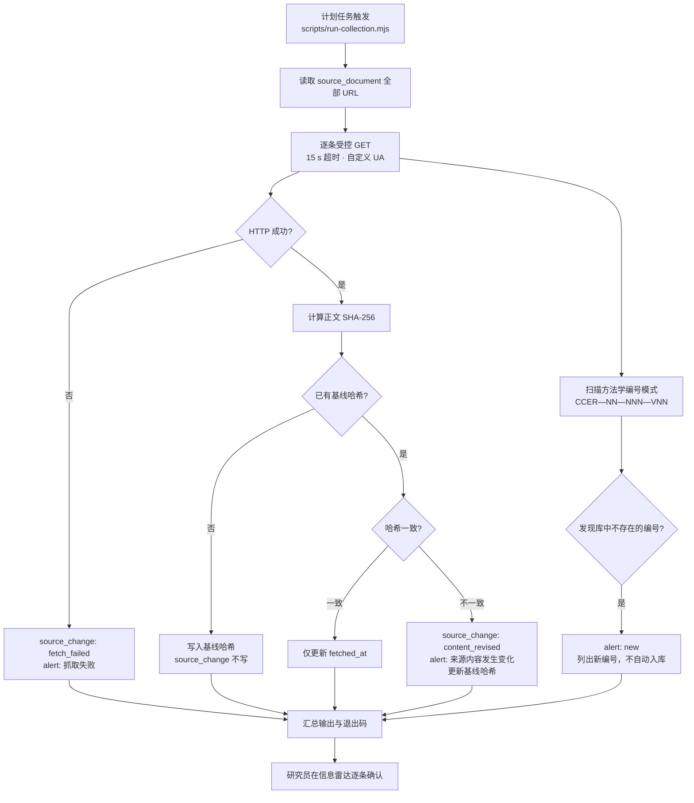

# 官方来源采集方案

> 设计文档第 4 节定义了数据源与更新机制。本文档给出可执行的采集方案、差异比对算法、
> 人工确认流程，以及当前实现与生产化建议的差距。

---

## 一、来源分级与准入

| 级别 | 范围 | 用途 | 准入条件 |
|---|---|---|---|
| **一级** | 生态环境部正式政策与方法学；全国 CCER 注册登记系统及信息平台上的方法学与项目/减排量公开信息；注册登记规则与项目设计实施指南；相关部委正式发布文件 | **驱动**申报资格判定与公式口径 | 必须有官方域名 URL、发布机关、文号或发布日期 |
| **二级** | 行业协会、研究机构、企业公告、媒体 | **仅**用于线索、解读与交叉核对 | `tier = 2` 且 `is_official = 0`；**不得**驱动申报资格与公式 |

系统实现：`source_document.tier`（1/2）与 `is_official` 两个独立列。
测试断言一级来源必须全部为官方。

**当前已登记的一级来源（8 条）**：

| # | 标题 | 发布机关 | 文号 | 发布日期 | 状态 |
|---:|---|---|---|---|---|
| 1 | 《温室气体自愿减排交易管理办法（试行）》 | 生态环境部、市场监管总局 | 生态环境部令 第31号 | 2023-10-19 | formal |
| 2 | 全国温室气体自愿减排注册登记系统及信息平台 | 国家应对气候变化战略研究和国际合作中心 | — | 2024-01-22 | notice |
| 3 | 《注册登记规则（试行）》《项目设计与实施指南》发布页 | 同上 | — | 2023-11-16 | formal |
| 4 | 2023 年首批 4 项方法学发布 | 生态环境部 | — | 2023-10-24 | formal |
| 5 | CCER-10-001-V01 发布通知 | 生态环境部办公厅、国家能源局综合司 | 环办气候函〔2025〕1号 | 2025-01-03 | formal |
| 6 | CCER-10-002/003/004-V01 发布通知 | 生态环境部办公厅、国家能源局综合司 | 环办气候函〔2025〕428号 | 2025-11-21 | formal |
| 7 | 就 2025 年发布的 12 项方法学答记者问 | 生态环境部 | — | 2026-01-08 | notice |
| 8 | 2026 年造林碳汇、红树林营造修订征求意见稿 | 生态环境部 | — | 2026-06-26 | draft |

**每条来源保存的字段**（设计文档第 4 节第 3 项要求）：URL、标题、发布机构、文号、发布日期、生效日、
抓取时间、原文件哈希、文件类型、是否官方、状态（征求意见/正式发布/修订/废止）、解析质量。

---

## 二、采集流程



### 2.1 编号扫描正则

```js
const METHODOLOGY_CODE_RE = /CCER[\u2014\u2013\-]\s?(\d{2})[\u2014\u2013\-]\s?(\d{3})[\u2014\u2013\-]\s?(V\d{2})/g;
```

兼容生态环境部常用的全角破折号 `—`（U+2014）、短破折号 `–`（U+2013）与半角连字符 `-`，
并容忍编号内部的空格。归一化输出格式为 `CCER-NN-NNN-VNN`。

**发现的编号只产生告警，不自动入库**——设计文档第 11 节明确「不得把网页搜索摘要当作规则源」。

### 2.2 差异比对

| 检测手段 | 能发现 | 局限 |
|---|---|---|
| 正文 SHA-256 比对 | 任何字节级内容变化（含公告撤回后的 404 页面变化） | 无法解释变化内容，需人工阅读 |
| HTTP 状态码 | 抓取失败、页面下架 | 若站点返回 200 + 错误页，需配合关键词检查 |
| 方法学编号扫描 | 新发布的方法学 | 依赖目录页把编号渲染进 HTML；动态渲染站点需人工核对 |
| 预期关键词检查 | 来源结构变化 | **未实现**（见第四节） |

### 2.3 当前已知的解析质量问题

`source_document.parse_quality` 与 `parse_note` 记录：

| 来源 | 解析质量 | 说明 |
|---|---|---|
| 全国 CCER 注册登记系统及信息平台 | `partial` | 目录页为动态渲染，需按固定周期人工核对条目数与编号；系统以官方目录为准 |
| 其余 7 条 | `good` | 静态 HTML，可直接比对与扫描 |

系统已就此生成 `structure_changed` 告警（`src/services/seed.mjs`），持续提示研究员人工核对。

---

## 三、人工确认流程（不可省略）

抓取环节**只写** `source_change` 与 `alert`，**绝不**修改 `methodology_version`、`rule`、`factor_version`。
这一硬约束由 `test/04-catalog-and-governance.test.mjs`「抓取结果不会自动修改方法学状态」断言保护。

研究员的确认动作（在「信息雷达」页面完成）：

| 变更类型 | 确认动作 |
|---|---|
| `content_revised`（内容修订） | 阅读变更内容 → 判断是否影响方法学适用条件、公式或因子 → 必要时新建方法学版本 / 修订规则卡 / 更新因子 → 标记确认 |
| `new`（发现新编号） | 在注册登记系统核对编号与名称 → 在 `src/data/catalog.mjs` 中补录条目 → 重跑种子 → 标记确认 |
| `fetch_failed`（抓取失败） | 检查站点可达性与受控出口策略 → 若公告撤回，更新来源 `status` → 标记确认 |
| `structure_changed`（结构变化） | 调整解析策略或改为人工核对 → 更新 `parse_quality` 与 `parse_note` → 标记确认 |
| `draft_consultation`（征求意见稿） | 保持草案状态，建立跟踪 → **不得**替换现行正式版本 |

确认动作写入 `source_change.review_status` / `reviewed_by` / `reviewed_at`，并留审计日志
（`audit` action = `source_change.confirm`）。

### 3.1 方法学状态发布链路

```text
source_change 确认
      ↓
methodology_version.document_status 变更（formal / draft / revised_draft / repealed）
      ↓
rulecard_status: none → candidate → approved      （由领域专家逐条核对规则卡）
      ↓
calculator_status: none → unverified → approved   （由领域专家校验公式与系数）
      ↓
factor_version.value_status: placeholder → verified
      ↓
管理后台切换 calculator_gate_mode: demo → strict
      ↓
此后任何仍含占位系数的插件都会被阻止出数
```

---

## 四、部署与调度

### 4.1 手动触发（工作台）

信息雷达页面提供两个按钮：

| 按钮 | 行为 |
|---|---|
| 演练比对（不发请求） | `POST /api/sources/sync { dryRun: true }` —— 只回显将处理哪些来源，不发起网络请求 |
| 执行受控抓取 | `POST /api/sources/sync { dryRun: false }` —— 发起真实请求 |

### 4.2 定时任务

```bash
# 每天 07:00 采集，日志追加
node scripts/run-collection.mjs >> logs/collection.log 2>&1
```

退出码：`0` 无变化；`2` 有变化或失败；`3` 采集被拒绝（权限）。计划任务可据退出码触发告警。

Windows 计划任务示例：

```powershell
$action  = New-ScheduledTaskAction -Execute "node" `
  -Argument "D:\AI workspace\ccer-screening\scripts\run-collection.mjs" `
  -WorkingDirectory "D:\AI workspace\ccer-screening"
$trigger = New-ScheduledTaskTrigger -Daily -At 7am
Register-ScheduledTask -TaskName "CCER来源采集" -Action $action -Trigger $trigger
```

### 4.3 受控出口

设计文档第 8 节要求「外部模型调用和官方站点采集须走受控出口，并由机构确认数据可否离开内网」。

本原型的实现边界：
- 采集是本系统**唯一**的出站网络调用点（`src/services/radar-svc.mjs` 的 `fetchWithTimeout`）。
- 系统**不调用任何外部大模型 API**，因此不存在「项目资料离开内网」的风险。
- 采集只发起对 `source_document` 表中已登记 URL 的 GET 请求，不做站点爬取、不携带任何项目数据。
- 生产化建议：在机构代理上为这些域名配置白名单，并将 UA 标识为机构内网应用
  （当前 UA 为 `CCER-Screening-Radar/1.0 (institution intranet; controlled egress)`）。

---

## 五、生产化建议与未实现项

| 编号 | 建议 | 当前状态 | 说明 |
|---|---|---|---|
| C-01 | 变更内容的结构化差异说明 | 仅记录哈希与人工填写的 `diff_summary` | 可引入 HTML 正文抽取 + 段落级 diff，生成可读的变更摘要 |
| C-02 | 来源结构变化自动检测 | 未实现 | 可对每条来源配置期望关键词/选择器，缺失时产生 `structure_changed` 告警 |
| C-03 | 动态渲染站点的采集 | 依赖人工核对（`parse_quality = 'partial'`） | 可引入无头浏览器，但需评估内网部署成本与安全影响 |
| C-04 | PDF 原件归档与哈希 | `original_file_hash` 列已就绪，未归档 | 方法学 PDF 应下载归档到对象存储并计算哈希，供条款页码追溯 |
| C-05 | 抓取频率与礼貌间隔 | 单次串行请求，无间隔 | 来源数量增大后应加入请求间隔与并发上限 |
| C-06 | 撤回检测 | 依赖 HTTP 状态码与哈希变化 | 可维护「历史出现过的标题集合」，标题消失时产生 `withdrawn` 告警 |
| C-07 | 变更影响面分析 | 未实现 | 可建立「规则/因子 ← 来源」引用图，来源变更时自动列出受影响的规则卡与插件 |
| C-08 | 二级来源接入 | 表结构支持（`tier = 2`），未录入 | 二级来源**禁止**驱动申报资格与公式，仅作线索 |

---

## 六、数据源与更新机制的字段映射

设计文档第 4 节逐条要求 → 实现位置：

| 设计文档要求 | 实现 |
|---|---|
| 一级来源：生态环境部政策与方法学 | `source_document` 中 tier=1 的 5 条方法学/政策来源 |
| 一级来源：注册登记系统的方法学与项目/减排量公开信息 | `src-registry`；项目状态六个布尔列 |
| 一级来源：注册登记规则与项目设计实施指南 | `src-reg-rules` |
| 一级来源：相关部委正式发布文件 | `src-notice-202511`（生态环境部办公厅 + 国家能源局综合司联合发布） |
| 二级来源仅用于线索、解读与交叉核对，不能驱动申报资格和公式 | `tier = 2` 与 `is_official = 0`；匹配引擎只读 `methodology_version`（由一级来源驱动） |
| 每条来源保存 URL、标题、发布机构、文号、发布日期、生效日、抓取时间、原文件哈希、文件类型、是否官方、状态、解析质量 | `source_document` 全部对应列 |
| PDF 保留原件、页码和抽取文本 | ⚠️ 未实现（C-04）；证据表 `project_evidence` 支持页码与原文片段 |
| 定时抓取后先做去重和差异比对 | `syncSources` 的 SHA-256 比对 + 编号扫描 |
| 再由研究员确认状态、影响领域和规则变更，批准后才发布到判断引擎 | `source_change.review_status` + 人工确认流程；抓取不写方法学表 |
| 抓取失败、来源结构变化和公告撤回须告警 | `alert.kind` ∈ {fetch_failed, structure_changed, withdrawn} |
| 同一方法学保留所有版本 | `UNIQUE(methodology_id, version)`，版本间 `supersedes_id` 串联 |
| 项目初筛和测算必须绑定「分析基准日 + 方法学版本 + 因子版本」 | `eligibility_run.analysis_base_date` + `calculation_run.analysis_base_date` / `methodology_version_id` / `factor_snapshot_json` |
| 历史报告不能因库更新而静默改写 | 报告引用运行 ID 快照（`report.snapshot_json`），内容落库（`report.content_json`） |
| 官方项目公开信息中的六个阶段分别建状态字段 | `project` 表六个独立布尔列 |
| 业主公示的预计量、核查报告确定的量、登记量分开存储 | `owner_announced_estimate` / `verified_amount` / `registered_amount` 三列 |
